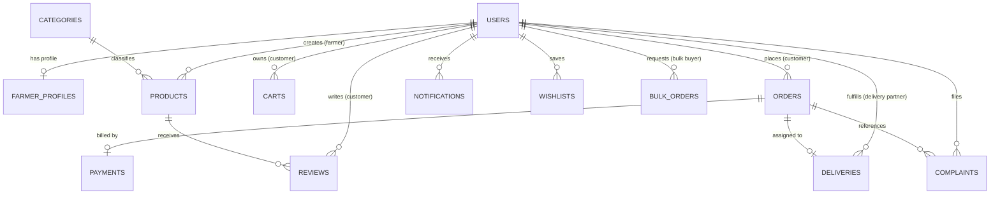

# RYTHU CONNECT – Database Architecture & Design

This document details the complete dual-database design for **RythuConnect**:
1. **MongoDB Atlas (Mongoose)** – Primary production database powering the reactive marketplace.
2. **SQLite (`rythu_academic.db`)** – Academic relational database demonstrating RDBMS theory, constraints, and relational joins.

---

## 1. MongoDB Database Design (Primary Marketplace)

### Collection Relationship Diagram



---

### MongoDB Collections Specification

#### 1. `users`
Core user identity supporting 5 roles: `FARMER`, `CUSTOMER`, `BULK_BUYER`, `DELIVERY_PARTNER`, `ADMIN`.
- `_id`: ObjectId (Primary Key)
- `name`: String (Required, trimmed)
- `email`: String (Required, unique, lowercase, indexed)
- `phone`: String (Required, unique)
- `password`: String (Required, hashed with `bcrypt`)
- `role`: String (Enum: `['FARMER', 'CUSTOMER', 'BULK_BUYER', 'DELIVERY_PARTNER', 'ADMIN']`, default: `'CUSTOMER'`)
- `status`: String (Enum: `['ACTIVE', 'PENDING_VERIFICATION', 'SUSPENDED']`, default: `'ACTIVE'`)
- `avatar`: String (Cloudinary URL or default)
- `address`: Embedded Object `{ street, city, district, state, pincode, coordinates: [lng, lat] }`
- `createdAt`: Timestamp
- `updatedAt`: Timestamp

#### 2. `farmerProfiles`
Extended KYC verification and farm metadata for users with role `FARMER`.
- `_id`: ObjectId
- `userId`: ObjectId (Ref: `User`, unique, indexed)
- `farmName`: String (Required)
- `farmLocation`: Object `{ village, mandal, district, state, pincode, coordinates: [lng, lat] }`
- `landSizeAcres`: Number (Min: 0.1)
- `farmingType`: String (Enum: `['ORGANIC', 'NATURAL', 'CONVENTIONAL', 'HYDROPONIC']`)
- `primaryCrops`: [String]
- `governmentIdType`: String (Enum: `['AADHAAR', 'PATTADAR_PASSBOOK', 'KISAN_CREDIT_CARD']`)
- `governmentIdNumber`: String (Encrypted/Masked)
- `verificationDocumentUrl`: String (Cloudinary secure storage URL)
- `verificationStatus`: String (Enum: `['PENDING', 'APPROVED', 'REJECTED']`, default: `'PENDING'`, indexed)
- `verifiedBy`: ObjectId (Ref: `User` [Admin])
- `verifiedAt`: Date
- `rejectionReason`: String
- `bankDetails`: Object `{ accountHolderName, accountNumber, ifscCode, bankName, upiId }`
- `rating`: Number (Default: 5.0, Min: 1, Max: 5)
- `totalSalesCount`: Number (Default: 0)

#### 3. `products`
Direct agricultural produce catalog.
- `_id`: ObjectId
- `farmerId`: ObjectId (Ref: `User`, Required, indexed)
- `categoryId`: ObjectId (Ref: `Category`, Required, indexed)
- `name`: String (Required, indexed for text search)
- `description`: String (Required)
- `pricePerUnit`: Number (Required, Min: 1)
- `unit`: String (Enum: `['KG', 'QUINTAL', 'BUNCH', 'LITRE', 'PIECE', 'DOZEN']`, default: `'KG'`)
- `availableStock`: Number (Required, Min: 0)
- `minimumOrderQuantity`: Number (Default: 1)
- `maximumOrderQuantity`: Number (Optional)
- `harvestDate`: Date (Required)
- `shelfLifeDays`: Number
- `farmingPractice`: String (Enum: `['ORGANIC', 'NATURAL', 'CONVENTIONAL']`)
- `images`: [String] (Cloudinary URLs)
- `isAvailable`: Boolean (Default: true, indexed)
- `isFeatured`: Boolean (Default: false)
- `traceability`: Object `{ farmDistrict, harvestBatchNumber, qrCodeUrl }`
- `averageRating`: Number (Default: 0)
- `numReviews`: Number (Default: 0)

#### 4. `categories`
Agricultural produce classification.
- `_id`: ObjectId
- `name`: String (Required, unique: Vegetables, Fruits, Grains & Pulses, Spices, Dairy)
- `slug`: String (Required, unique, lowercase)
- `description`: String
- `icon`: String (URL or icon identifier)
- `isActive`: Boolean (Default: true)

#### 5. `carts`
Customer transient shopping cart before checkout.
- `_id`: ObjectId
- `customerId`: ObjectId (Ref: `User`, unique, indexed)
- `items`: [
    - `productId`: ObjectId (Ref: `Product`)
    - `farmerId`: ObjectId (Ref: `User`)
    - `quantity`: Number (Min: 1)
    - `priceAtAddition`: Number
  ]
- `updatedAt`: Timestamp

#### 6. `orders`
Immutable transactional record with state transition guards.
- `_id`: ObjectId
- `orderNumber`: String (Unique, e.g., `RC-20261123-0001`, indexed)
- `customerId`: ObjectId (Ref: `User`, Required, indexed)
- `items`: [
    - `productId`: ObjectId (Ref: `Product`)
    - `farmerId`: ObjectId (Ref: `User`)
    - `productName`: String
    - `unit`: String
    - `pricePerUnit`: Number
    - `quantity`: Number
    - `subtotal`: Number
  ]
- `totalItemsPrice`: Number
- `deliveryFee`: Number
- `platformFee`: Number
- `totalAmount`: Number (Required)
- `deliveryAddress`: Object `{ recipientName, phone, street, city, district, pincode, coordinates: [lng, lat] }`
- `orderStatus`: String (Enum: `['PLACED', 'CONFIRMED', 'PACKED', 'PICKED_UP', 'OUT_FOR_DELIVERY', 'DELIVERED', 'CANCELLED']`, default: `'PLACED'`, indexed)
- `deliveryOtp`: String (6-digit hashed OTP for physical delivery validation)
- `paymentStatus`: String (Enum: `['PENDING', 'PAID', 'FAILED', 'REFUNDED']`, default: `'PENDING'`)
- `paymentMethod`: String (Enum: `['ONLINE_RAZORPAY', 'COD', 'UPI']`)
- `placedAt`: Date (Default: Date.now)
- `deliveredAt`: Date
- `cancellationReason`: String

#### 7. `payments`
Auditable financial payment records.
- `_id`: ObjectId
- `orderId`: ObjectId (Ref: `Order`, Required, unique, indexed)
- `userId`: ObjectId (Ref: `User`, Required)
- `gateway`: String (Enum: `['RAZORPAY', 'CASH_ON_DELIVERY', 'MOCK_SANDBOX']`)
- `gatewayOrderId`: String
- `gatewayPaymentId`: String
- `gatewaySignature`: String
- `amount`: Number (Required)
- `currency`: String (Default: `'INR'`)
- `status`: String (Enum: `['CREATED', 'SUCCESS', 'FAILED']`, default: `'CREATED'`)
- `escrowStatus`: String (Enum: `['HELD', 'DISBURSED_TO_FARMER', 'REFUNDED']`, default: `'HELD'`)
- `verifiedAt`: Date

#### 8. `deliveries`
Fulfillment and logistics tracking for delivery partners.
- `_id`: ObjectId
- `orderId`: ObjectId (Ref: `Order`, Required, unique, indexed)
- `deliveryPartnerId`: ObjectId (Ref: `User`, indexed)
- `pickupLocations`: [{ farmerId: ObjectId, address: Object, isPickedUp: Boolean, pickedUpAt: Date }]
- `dropLocation`: Object (Customer address)
- `status`: String (Enum: `['ASSIGNED', 'ACCEPTED', 'PICKED_UP', 'IN_TRANSIT', 'DELIVERED', 'FAILED']`, default: `'ASSIGNED'`)
- `otpVerified`: Boolean (Default: false)
- `assignedAt`: Date
- `deliveredAt`: Date

#### 9. `reviews`
Verified buyer feedback restricted to delivered orders.
- `_id`: ObjectId
- `productId`: ObjectId (Ref: `Product`, Required, indexed)
- `orderId`: ObjectId (Ref: `Order`, Required)
- `customerId`: ObjectId (Ref: `User`, Required)
- `rating`: Number (Required, Min: 1, Max: 5)
- `comment`: String
- `createdAt`: Timestamp

#### 10. `notifications`
Real-time transactional and status alerts.
- `_id`: ObjectId
- `recipientId`: ObjectId (Ref: `User`, Required, indexed)
- `title`: String (Required)
- `message`: String (Required)
- `type`: String (Enum: `['ORDER_UPDATE', 'KYC_STATUS', 'INVENTORY_ALERT', 'PROMOTION']`)
- `link`: String
- `isRead`: Boolean (Default: false)
- `createdAt`: Timestamp

#### 11. `wishlists`
Customer curated favorites.
- `_id`: ObjectId
- `customerId`: ObjectId (Ref: `User`, unique, indexed)
- `products`: [ObjectId] (Ref: `Product`)

#### 12. `bulkOrders`
B2B procurement requests for bulk buyers (restaurants, retailers).
- `_id`: ObjectId
- `buyerId`: ObjectId (Ref: `User`, Required, indexed)
- `farmerId`: ObjectId (Ref: `User`, Required, indexed)
- `productId`: ObjectId (Ref: `Product`, Required)
- `requestedQuantity`: Number (Required, Min: 20)
- `unit`: String
- `targetPricePerUnit`: Number
- `offeredPricePerUnit`: Number
- `status`: String (Enum: `['REQUESTED', 'QUOTED', 'ACCEPTED', 'REJECTED', 'FULFILLED']`, default: `'REQUESTED'`)
- `deliveryCadence`: String (Enum: `['ONE_TIME', 'WEEKLY', 'MONTHLY']`)
- `notes`: String

#### 13. `complaints`
Quality assurance and dispute escalation to platform admins.
- `_id`: ObjectId
- `userId`: ObjectId (Ref: `User`, Required)
- `orderId`: ObjectId (Ref: `Order`)
- `category`: String (Enum: `['QUALITY_ISSUE', 'DELAYED_DELIVERY', 'INCORRECT_QUANTITY', 'OVERCHARGED', 'OTHER']`)
- `description`: String (Required)
- `status`: String (Enum: `['OPEN', 'IN_INVESTIGATION', 'RESOLVED', 'DISMISSED']`, default: `'OPEN'`)
- `resolutionNotes`: String
- `resolvedBy`: ObjectId (Ref: `User` [Admin])

---

## 2. SQLite Database Design (`rythu_academic.db` - Module 2)

This standalone relational database strictly demonstrates 1st-year RDBMS syllabus concepts: DDL constraints (`PRIMARY KEY`, `FOREIGN KEY`, `NOT NULL`, `UNIQUE`, `CHECK`), DML operations, and relational joins.

### SQLite Schema (`schema.sql`)

```sql
-- 1. Farmers Table
CREATE TABLE IF NOT EXISTS farmers (
    id INTEGER PRIMARY KEY AUTOINCREMENT,
    name TEXT NOT NULL,
    phone TEXT NOT NULL UNIQUE,
    village TEXT NOT NULL,
    district TEXT NOT NULL,
    acres REAL CHECK (acres > 0),
    is_verified INTEGER DEFAULT 0 CHECK (is_verified IN (0, 1)),
    created_at DATETIME DEFAULT CURRENT_TIMESTAMP
);

-- 2. Customers Table
CREATE TABLE IF NOT EXISTS customers (
    id INTEGER PRIMARY KEY AUTOINCREMENT,
    name TEXT NOT NULL,
    email TEXT NOT NULL UNIQUE,
    phone TEXT NOT NULL,
    city TEXT NOT NULL,
    created_at DATETIME DEFAULT CURRENT_TIMESTAMP
);

-- 3. Products Table
CREATE TABLE IF NOT EXISTS products (
    id INTEGER PRIMARY KEY AUTOINCREMENT,
    farmer_id INTEGER NOT NULL,
    product_name TEXT NOT NULL,
    category TEXT NOT NULL CHECK (category IN ('Vegetables', 'Fruits', 'Grains', 'Spices', 'Dairy')),
    price_per_kg REAL NOT NULL CHECK (price_per_kg > 0),
    stock_kg REAL NOT NULL CHECK (stock_kg >= 0),
    harvest_date TEXT NOT NULL,
    created_at DATETIME DEFAULT CURRENT_TIMESTAMP,
    FOREIGN KEY (farmer_id) REFERENCES farmers(id) ON DELETE CASCADE
);

-- 4. Orders Table
CREATE TABLE IF NOT EXISTS orders (
    id INTEGER PRIMARY KEY AUTOINCREMENT,
    customer_id INTEGER NOT NULL,
    order_date DATETIME DEFAULT CURRENT_TIMESTAMP,
    total_amount REAL NOT NULL CHECK (total_amount >= 0),
    status TEXT NOT NULL DEFAULT 'PLACED' CHECK (status IN ('PLACED', 'CONFIRMED', 'DELIVERED', 'CANCELLED')),
    FOREIGN KEY (customer_id) REFERENCES customers(id) ON DELETE CASCADE
);

-- 5. Order Items Table (Junction Table)
CREATE TABLE IF NOT EXISTS order_items (
    id INTEGER PRIMARY KEY AUTOINCREMENT,
    order_id INTEGER NOT NULL,
    product_id INTEGER NOT NULL,
    quantity_kg REAL NOT NULL CHECK (quantity_kg > 0),
    unit_price REAL NOT NULL CHECK (unit_price > 0),
    subtotal REAL NOT NULL CHECK (subtotal > 0),
    FOREIGN KEY (order_id) REFERENCES orders(id) ON DELETE CASCADE,
    FOREIGN KEY (product_id) REFERENCES products(id) ON DELETE RESTRICT
);
```

### Relational Join Demonstrations
1. **Inner Join: Farmer Produce Catalog**
   ```sql
   SELECT f.name AS farmer_name, f.district, p.product_name, p.category, p.price_per_kg, p.stock_kg
   FROM farmers f
   JOIN products p ON f.id = p.farmer_id
   WHERE f.is_verified = 1;
   ```
2. **Multi-Table Join: Customer Detailed Order Itemization**
   ```sql
   SELECT o.id AS order_id, c.name AS customer_name, p.product_name, f.name AS farmer_name,
          oi.quantity_kg, oi.unit_price, oi.subtotal, o.status
   FROM orders o
   JOIN customers c ON o.customer_id = c.id
   JOIN order_items oi ON o.id = oi.order_id
   JOIN products p ON oi.product_id = p.id
   JOIN farmers f ON p.farmer_id = f.id;
   ```
