# RYTHU CONNECT – Project Overview

> **Tagline:** *From Farmers to Your Homes – Fresh, Fair and Direct.*  
> **Category:** AgriTech | E-commerce | Social Impact  
> **Architecture:** MERN Stack (MongoDB, Express.js, React.js, Node.js) + SQLite Educational Module

---

## 1. Executive Summary

**RYTHU CONNECT** is a next-generation smart agricultural marketplace engineered to eliminate predatory middleman commissions, empower Indian farmers with direct pricing authority, and provide consumers and bulk institutions (restaurants, hotels, retailers) with verified, farm-fresh produce with farm-to-fork traceability.

Rather than being a trivial college CRUD application, RythuConnect is built with an enterprise-grade modular architecture adhering to clean code standards, strict role-based access control, secure transaction lifecycles, and complete syllabus integration for 1st-year computer science backend modules.

---

## 2. Core Stakeholders & 5 Distinct Dashboards

```mermaid
graph TD
    A[RythuConnect Platform] --> B[Farmer Dashboard]
    A --> C[Customer Dashboard]
    A --> D[Bulk Buyer Dashboard]
    A --> E[Delivery Partner Dashboard]
    A --> F[Admin Dashboard]

    B --> B1[Product Listings & Fair Pricing]
    B --> B2[Live Order Requests & Inventory]
    B --> B3[Direct Earnings & Sales Reports]

    C --> C1[Direct Farm Produce Catalog]
    C --> C2[Smart Price Comparison & Traceability]
    C --> C3[Cart, Checkout & Live Order Tracking]

    D --> D1[Institutional Bulk Inquiries]
    D --> D2[Quotations & Recurring Harvest Contracts]

    E --> E1[Assigned Route Pickups]
    E --> E2[Farmer Geolocation & Customer OTP Handover]

    F --> F1[Farmer KYC Verification]
    F --> F2[Marketplace Quality & Dispute Resolution]
    F --> F3[System-wide Analytics & Moderation]
```

---

## 3. Dual Database Architecture Strategy

A key engineering decision in RythuConnect is the purposeful division between **MongoDB** (Production NoSQL Engine) and **SQLite** (Relational Academic Module):

1. **MongoDB Atlas (Primary Marketplace Database):**
   - Handles all active e-commerce operations: dynamic product catalogues, multi-item carts, geospatial farm locations, real-time order state machines, reviews, and notifications.
   - Built with Mongoose ODM with strong validation, embedded documents where appropriate, and indexed references.

2. **SQLite (`rythu_academic.db` - Academic Relational Demonstration Module):**
   - Fulfills the strict 1st-year academic syllabus requirements for Relational Database Management Systems (RDBMS).
   - Demonstrates DDL (tables, primary keys, foreign keys, CHECK/UNIQUE/NOT NULL constraints), DML (INSERT, SELECT, UPDATE, DELETE), parameterized queries to prevent SQL injection, and complex relational SQL JOINs across farmers, products, and orders.
   - Runs independently with dedicated educational API endpoints (`/api/v1/academic/sqlite/*`), preventing concurrency conflicts with production data.

---

## 4. Key Differentiating Features

- **Smart Farm-to-Fork Traceability:** Each product batch features origin metadata (district, harvest date, soil/farming practice - Organic/Natural/Conventional) and QR code generation for customer verification.
- **Fair Price Transparency:** Real-time breakdown displaying the exact amount received by the farmer vs. platform/logistics costs.
- **Weekly Vegetable Subscription Box:** Recurring customizable vegetable and fruit basket delivery for urban households directly sourced from local clusters.
- **B2B Bulk Quotation Engine:** Restaurants and supermarkets can negotiate bulk orders directly with farmer cooperatives.
- **OTP-Secured Physical Handover:** Delivery partners must verify customer OTP upon drop-off to transition orders to `DELIVERED` status and release escrow balance.
